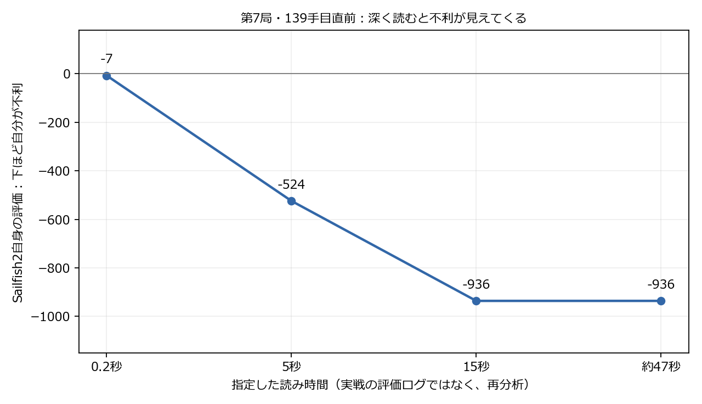
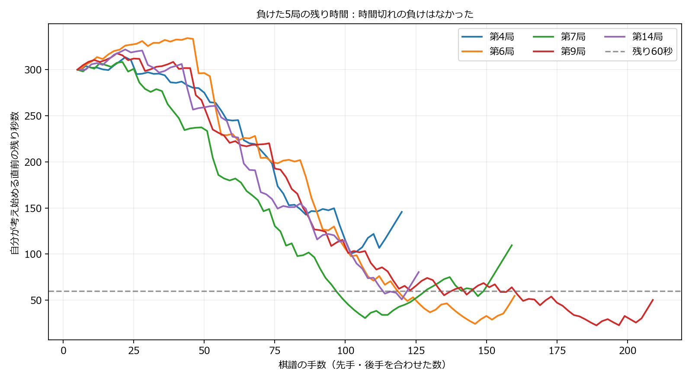

# 時間配分版が負けた5局の原因調査（2026-10-04）

## わかったこと

時間切れが直接の敗因だった局はない。5局とも詰みで終わり、最後の自分の手を指した後にも約60〜156秒が残った。序盤の節約を取り消す根拠は今回の調査では見つからない。
ただし、時間を残すだけで局面の判断や読み落としが解決するわけではない。第7局では、深く読むと評価が大きく悪化し、実戦とは別の手を選んだ。その手を指しても不利なままで、139手目を唯一の敗着と断定することはできない。
第4・6・9・14局の候補局面では、実際の手より明確に改善する代案を長い再分析で確認できなかった。原因候補は中盤から終盤の攻防を十分に見通せないことだが、探索と評価関数のどちらが主因かはまだ切り分け切れていない。

## 対局と調べ方

対象はTime版対旧Delta版の20局（13勝5敗2分）のうち、Time版が負けた第4・6・7・9・14局。floodgateの15局とは別のローカル比較。5分＋毎手10秒、Threads1、Hash64MB、対局時NetworkDelay120ms、ランダムな歩4手の序盤を先後ペアで使用。
保存されたseedと対局ツールの同じ序盤生成関数から最初4手を再現し、cshogiで5局全手の合法性を確認した。違法手0。実測時間は保存済みtraceを使用。
全759局面を200msで一度ずつ再分析した（117＋157＋156＋206＋123局面）。短い評価で悪化した自分の手を各局3候補選び、親局面・実際の手の後・代案の後を5秒、候補1局面を15秒で確認した。その後、各局の重要局面を実戦の3倍以上・最低45秒で読み直し、実際の手と代案を指した後を同じ30秒で比較した。第9局などの一手しか指せない終盤は原因候補から除外し、もっと前の局面を長時間確認した。
再分析も同じTime版＋R5を使用、Threads1/Hash64、固定読み時間、各検索前に置換表と探索状態をリセット。実戦中の評価・PVは対局ツールに記録されていない。実戦時の履歴・置換表を完全再現した実験ではない。
評価値は手番側からTime版側へ統一。マイナスはTime版が不利という意味。点数は同じソフト自身の判断であり、強い別のソフトによる正解認定や実際の勝率ではない。詰みの評価を便宜上±30000に置いた行と、指せる手が一手の行は比較の解釈に注意する。

## 5局の重要局面

下表の「残り」は実戦でその手を考え始めた時点。「手の後の評価」は、それぞれの手を指した後に30秒読み直した値。代案との差が小さい場合や、代案の方が悪い場合は、実戦の手を敗着扱いしない。

|対局|局面|実戦の手|実戦消費／残り|長考で選んだ手|実戦の手の後／代案の後|
|---|---:|---|---:|---|---:|
|第4局|56手目|6四角打|20.1秒／255.6秒|2二飛（2一から）|-514／-627|
|第6局|80手目|7三歩打|11.9秒／202.3秒|7三歩打|-614／-614|
|第7局|139手目|6四歩打|15.8秒／66.1秒|7八銀（8九から）|-1558／-1435|
|第9局|143手目|3八飛（3九から）|4.8秒／56.1秒|3八飛（3九から）|-427／-427|
|第14局|90手目|6八飛打|5.2秒／115.8秒|6八飛打|-509／-509|

### 第4局：時間不足では説明しにくい中盤の悪化

56手目に6四角を打った。実戦では約20秒を使い、その直前に約256秒残っていた。約60秒の再分析は2二飛を選ぶが、手の後を30秒ずつ評価すると実戦の角打ち−514、代案−627。代案の方が良いとは確認できない。5秒・15秒・約60秒で候補手が変わるため、短い分析だけで角打ちを敗着としない。長考時には手を指す前から−528であり、もっと前の構想・攻防を調べる余地がある。

### 第6局：長く読んでも同じ歩打ち

80手目の7三歩打ちを45秒の再分析でも選んだ。実戦では約12秒使い、残り約202秒。手の後の30秒評価は−614。後の98手目の7二銀打ちも15秒の再分析で同じ手となった。選んだ局面では、時間の追加だけで救える明確な一手を確認できていない。

### 第7局：深く読むと不利が見える終盤

139手目の6四歩打ちの直前は、200msの再分析では−7とほぼ互角に見えた。しかし5秒では−524、15秒と約47秒では−936で、7八銀（8九から）を選ぶ。実戦では約15.8秒使用、残り約66秒。
手の後を同じ30秒で比較すると、歩打ちは−1558、銀を動かす案は−1435。銀の案の方が123良いが、どちらも不利。5秒比較の差221、15秒比較の差414、30秒比較の差123と幅も揺れる。この一手を変えれば勝てたとは言えない。短い読みで危険を軽く見積もる傾向と、複雑な攻防で判断が安定しにくいことを示す診断例として保存する。
約47秒検索でも最後に完了した反復は深さ11・約9.9秒時点だった。残りの検索時間では次の深さが完成しなかった。時間を増やすだけでなく、重要な応手を効率よく読む改善も必要な候補となる。

### 第9局：一手しかない終盤を敗着と誤認しない

終盤の205手目は王手に対して8八玉しか合法手がない。短い検索ではプラス評価が表示されても、その手の後を調べると詰みが見つかるため、プラスから詰みに落ちたという数値だけでこの玉の手を敗着としない。
もっと前の143手目の3八飛（3九から）を45秒でも選び、手の後の30秒評価は−427。実戦消費約4.8秒。選んだ局面で、長考によって改善する代案は見つからなかった。長い攻防のどこで勝ち筋を失ったかは追加調査が必要。

### 第14局：飛車打ちの代案は未確認

90手目の6八飛打ちを45秒でも選んだ。実戦消費約5.2秒、手の後の30秒評価は−509。後の104手目の7九銀打ちも15秒で同じ手を選ぶ。末尾の大きな評価変動は既に不利な局面や詰みの評価が混ざるため、そのまま敗着とは扱わない。

## 時間の残り方

|対局|対局中の自分の最小残り時間（考え始め）|最後の自分の手の後の残り|
|---|---:|---:|
|第4局|100.6秒|155.8秒|
|第6局|24.3秒|64.8秒|
|第7局|30.7秒|119.6秒|
|第9局|22.7秒|60.3秒|
|第14局|50.9秒|90.5秒|

## 探索の省略を変える追加診断

同じ重要局面を各100万ノードで、標準／LMRなし／ヌルムーブなし／静かな手の枝刈りなし／静止探索の枝刈りなしの5条件で比較した。LMRは後で試す手を浅く読む処理、ヌルムーブは仮に一手休んでも有利なら一部の読みを省く処理。どれを外しても同じ深さまで読む費用は変わるので、手が変わっただけで「この省略が原因」とは言えない。
全局に効く原因を確定するための試験ではなく、局面ごとの読みの揺れを調べる追加診断。診断設定は標準実行ファイルへ反映していない。

|対局|標準|LMRなし|ヌルムーブなし|静かな手の枝刈りなし|静止探索の枝刈りなし|
|---|---|---|---|---|---|
|第4局|3c2e / -343 / 深さ12|B*3i / -290 / 深さ8|3c2e / -344 / 深さ12|3c2e / -269 / 深さ10|3c2e / -344 / 深さ12|
|第6局|P*7c / -426 / 深さ9|P*7g / -223 / 深さ6|P*7c / -398 / 深さ8|P*7g / -269 / 深さ6|P*7c / -398 / 深さ8|
|第7局|8i7h / -524 / 深さ9|8i7h / -314 / 深さ6|8i7h / -524 / 深さ9|8i7h / -318 / 深さ7|8i7h / -403 / 深さ7|
|第9局|3e3d / -265 / 深さ6|3e3d / -406 / 深さ5|6c5b / -496 / 深さ7|3e3d / -265 / 深さ6|3e3d / -265 / 深さ6|
|第14局|R*6h / -411 / 深さ8|8f8a / -323 / 深さ6|R*6h / -509 / 深さ8|8f8a / -380 / 深さ5|R*6h / -597 / 深さ8|

## 次に直すなら

まず診断局面を固定して、重要な相手の応手を早く読む指し手の並べ方や、複雑な局面で読みを省略する条件を一つずつ試す。省略を全面的に外すと深く読めなくなるため、一括で弱めるのは避ける。
時間配分は序盤の節約を保ちつつ、評価が急変した局面や次の反復が非常に長い局面を観測できるログを加える案が有用。今回の勝敗ログには実戦の評価とPVがなく、原因判定の限界になった。追加ログは今後の実装候補であり、この調査では対局ツールや標準版を変更していない。
評価関数の追加学習は、探索改善で救えない局面を分けてから試す。今回の5敗だけから公開教師データの大量学習を優先する根拠はまだない。
今回の局面は開発用の診断集合として保存する。これらの局面で良くなることだけを採用条件にせず、未使用の序盤での対局比較でも強さを確かめる。

## 保存先・再現情報

- 元対局：baseline/time_clock20.json
- 全局面・候補・長時間PV：baseline/time_loss_analysis/analysis.json
- 集計：baseline/time_loss_analysis/summary.json
- 省略の切替診断：baseline/time_loss_analysis/ablation.json
- 棋譜：baseline/time_loss_analysis/game_04.usi.txtほか5局
- スクリプト：tools/analyze-time-losses.py、tools/confirm-time-losses.py、tools/ablate-time-losses.py、tools/report-time-losses.py
- 分析exe：baseline/sailfish2_time_candidate.exe / SHA256 1129d6fee951d405246745b065724d32c5c908f2c4748b20af7fb660c5457f2c
- 標準exe・R5・アプリ同梱版は変更していない。Git公開なし。
