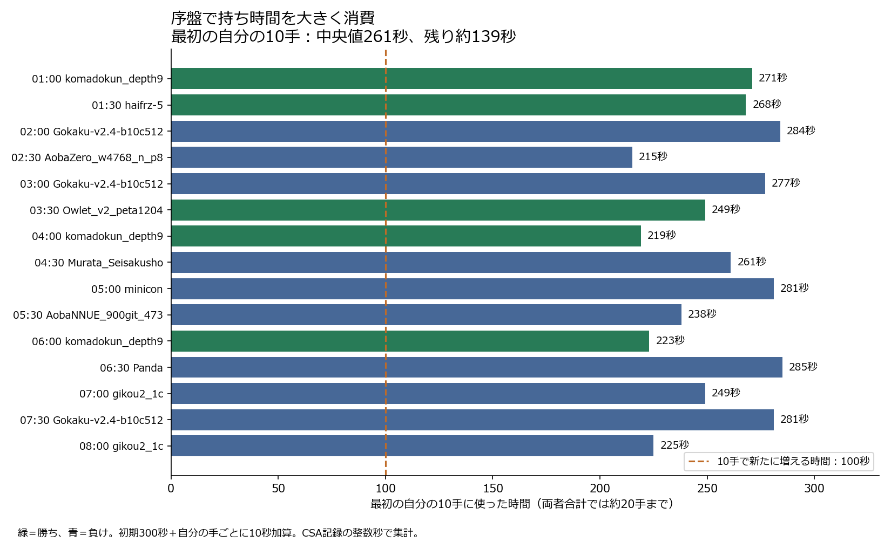

# Sailfish2のfloodgate15局：時間配分と負け方の調査
対象: 2026年10月3日01:00〜08:00開始の15局。参加者名sailfish2、識別子10d9928。

## 結論
「序盤に時間を使いすぎる」という観察を、消費時間から確認できた。
最初の自分の10手で使った時間の中央値は261秒。初期300秒に10手分の加算100秒があるため、その時点の残りは中央値139秒。
自分の20手後（両者合計では約40手）の残りは中央値67秒。15局中14局で、その後の残り時間が60秒未満になった。
最初の自分の10手は平均25.5秒/手、各対局の最後の自分の10手は平均5.3秒/手だった。序盤と終盤では局面の難しさや勝敗も異なるため、平均だけで使うべき時間を断定しない。

15局は5勝10敗。全局が投了で終了しており、記録上の時間切れ・反則終局はない。時間切れの敗戦ではなく、後半に使える時間が少なくなる配分が課題。ただし相手の棋力も影響しており、時間配分だけで10敗を説明できるとは限らない。

## 15局の一覧
時間欄は秒。10手・20手はSailfish自身の着手数。残り時間は加算後。開始時刻から公開棋譜を開ける。

| 開始 | 相手 | 対局時の相手レート | 結果 | 最初10手の消費 | 10手後の残り | 20手後の残り |
|---|---|---:|---|---:|---:|---:|
| [01:00](https://wdoor.c.u-tokyo.ac.jp/shogi/x/2026/10/03/wdoor+floodgate-300-10F+komadokun_depth9+sailfish2+20261003010005.html) | komadokun_depth9 | 2388 | 勝 | 271 | 129 | 64 |
| [01:30](https://wdoor.c.u-tokyo.ac.jp/shogi/x/2026/10/03/wdoor+floodgate-300-10F+sailfish2+haifrz-5+20261003013005.html) | haifrz-5 | 2534 | 勝 | 268 | 132 | 54 |
| [02:00](https://wdoor.c.u-tokyo.ac.jp/shogi/x/2026/10/03/wdoor+floodgate-300-10F+Gokaku-v2.4-b10c512-v500+sailfish2+20261003020002.html) | Gokaku-v2.4-b10c512-v500 | 3171 | 敗 | 284 | 116 | 52 |
| [02:30](https://wdoor.c.u-tokyo.ac.jp/shogi/x/2026/10/03/wdoor+floodgate-300-10F+sailfish2+AobaZero_w4768_n_p800+20261003023000.html) | AobaZero_w4768_n_p800 | 3369 | 敗 | 215 | 185 | 102 |
| [03:00](https://wdoor.c.u-tokyo.ac.jp/shogi/x/2026/10/03/wdoor+floodgate-300-10F+Gokaku-v2.4-b10c512-v500+sailfish2+20261003030003.html) | Gokaku-v2.4-b10c512-v500 | 3172 | 敗 | 277 | 123 | 51 |
| [03:30](https://wdoor.c.u-tokyo.ac.jp/shogi/x/2026/10/03/wdoor+floodgate-300-10F+sailfish2+Owlet_v2_peta1204+20261003033000.html) | Owlet_v2_peta1204 | 2658 | 勝 | 249 | 151 | 75 |
| [04:00](https://wdoor.c.u-tokyo.ac.jp/shogi/x/2026/10/03/wdoor+floodgate-300-10F+sailfish2+komadokun_depth9+20261003040003.html) | komadokun_depth9 | 2387 | 勝 | 219 | 181 | 93 |
| [04:30](https://wdoor.c.u-tokyo.ac.jp/shogi/x/2026/10/03/wdoor+floodgate-300-10F+Murata_Seisakusho+sailfish2+20261003043007.html) | Murata_Seisakusho | 3917 | 敗 | 261 | 139 | 80 |
| [05:00](https://wdoor.c.u-tokyo.ac.jp/shogi/x/2026/10/03/wdoor+floodgate-300-10F+minicon+sailfish2+20261003050006.html) | minicon | 4355 | 敗 | 281 | 119 | 58 |
| [05:30](https://wdoor.c.u-tokyo.ac.jp/shogi/x/2026/10/03/wdoor+floodgate-300-10F+AobaNNUE_900git_473stb_10m+sailfish2+20261003053003.html) | AobaNNUE_900git_473stb_10m | 3811 | 敗 | 238 | 162 | 93 |
| [06:00](https://wdoor.c.u-tokyo.ac.jp/shogi/x/2026/10/03/wdoor+floodgate-300-10F+komadokun_depth9+sailfish2+20261003060002.html) | komadokun_depth9 | 2386 | 勝 | 223 | 177 | 74 |
| [06:30](https://wdoor.c.u-tokyo.ac.jp/shogi/x/2026/10/03/wdoor+floodgate-300-10F+Panda+sailfish2+20261003063002.html) | Panda | 3349 | 敗 | 285 | 115 | 65 |
| [07:00](https://wdoor.c.u-tokyo.ac.jp/shogi/x/2026/10/03/wdoor+floodgate-300-10F+sailfish2+gikou2_1c+20261003070002.html) | gikou2_1c | 3300 | 敗 | 249 | 151 | 67 |
| [07:30](https://wdoor.c.u-tokyo.ac.jp/shogi/x/2026/10/03/wdoor+floodgate-300-10F+sailfish2+Gokaku-v2.4-b10c512-v500+20261003073003.html) | Gokaku-v2.4-b10c512-v500 | 3172 | 敗 | 281 | 119 | 40 |
| [08:00](https://wdoor.c.u-tokyo.ac.jp/shogi/x/2026/10/03/wdoor+floodgate-300-10F+sailfish2+gikou2_1c+20261003080001.html) | gikou2_1c | 3300 | 敗 | 225 | 175 | 114 |

相手レートは当該CSAに記録された値で、現在のレートではない。2650程度の相手に勝ったという話は、03:30のOwlet_v2_peta1204（2658）への勝利と一致した。

## 負け方から分かること
負けた10局のうち9局では、Sailfish自身が初めて評価−500以下を返した時点で、推定残り時間が60秒以下だった。評価−500は診断の目安で、敗着や勝敗確定を意味しない。この相関だけでは時間不足が悪化を引き起こしたと証明できない。

- 07:00のgikou2_1c戦: 43手目（自分の22手目）で自己評価−758、残り約56秒。53手目で−1076、残り約35秒。序盤の自分の10手に249秒を使っていた。
- 06:30のPanda戦: 52手目の自己評価+74から54手目で−545へ変化。54手目後の残り約41秒。自分の着手と相手の応手の両方を含む変化なので、52手目を敗着と断定しない。
- 03:00のGokaku戦: 34手目で自己評価−697、残り約70秒。時間がまだあるうちにも悪化しており、探索や評価の弱点も調べる必要がある。
- 02:30のAobaZero戦: 121手目で初めて自己評価−500以下（−940）。途中までは自己評価が大きく悪くなく、相手の攻めの見積もりを再確認する候補になる。

評価はSailfish自身のコメントだけを比較した。相手とは尺度や探索が違うため、そのまま同じ列に混ぜていない。コメントは先手視点として扱い、Sailfishが後手なら符号を反転した。具体的な敗着・詰みの見落としの確定には、分岐の再探索が必要であり、今回は断定していない。

## コードと観測が一致する点
src/main.rsの式は、加算10秒・残り300秒なら通常終了の目安が約14.9秒、強制停止の目安が約47.4秒（NetworkDelay120msの既定値を仮定）。
src/search.rsでは通常終了の目安を反復深化の1周が終わったところで判定するため、次の深さの探索が長いと、この目安を大きく超えることがある。実際、各局の最大消費は35〜47秒だった。
現行式には序盤の手数や候補手の安定性を使う配分がなく、中盤に時間を残す明示的な予約もない。
ただし公開棋譜には当時のUSIログがなく、当時の実際の設定やsoft/hard値を直接確認したわけではない。ソースの式との整合性からの説明である。

## 次に試す案
まず時間配分だけを変更した実験版を別保存し、R5と探索内容は維持して効果を分ける。

1. 序盤で使う時間を抑え、中盤用の時間を残す。
2. 次の深さを読み始める前に、目標時間で1周を終えられそうか見積もる。
3. 候補が安定している局面は早めに指し、候補が変わる難しい局面へ時間を使う。
4. 5分＋1手10秒、同じCPU・スレッド数で先後を交換して対局検証する。毎手150msの比較では時間配分の効果を測れない。

この調査ではエンジンの時間配分コードや標準実行ファイルを変更していない。

## 追加1局と測定上の限界
公開記録には08:30開始のPanda戦もあり、こちらは敗戦。主集計の15局とは別に保存。全16局の指し手をcshogiで合法性検査し、不正な手は0。追加を含めると5勝11敗。

残り時間は初期300秒＋各自の着手ごとに10秒加算として、CSAの整数秒Tから復元した近似。秒未満や通信側の処理は完全には再現できない。低い残り時間の細かな数字にはこの限界がある。

## 保存物と参照先
- [公開参加者ページ](https://wdoor.c.u-tokyo.ac.jp/shogi/x/2026/player/sailfish2+10d9928.html)
- [floodgateの持ち時間・接続案内](https://wdoor.c.u-tokyo.ac.jp/shogi/)
- 保存棋譜: data/floodgate_sailfish2_20261003/（全16局）
- 取得URL一覧: baseline/floodgate_sailfish2_sources.json
- 各手の時間・局面・評価: baseline/floodgate_sailfish2_analysis.json
- 再現ツール: tools/analyze-sailfish-floodgate.py
