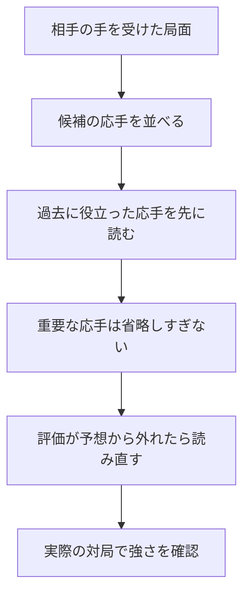

# 複雑な攻防を早く読むための探索実験（2026年10月4日）

**4種類の改善案を実装して検証しましたが、今回は標準版への採用を見送りました。現在使えるSailfish2は、序盤の時間を抑える「Codex Delta Time」のままです。** 改善を確認できた新しい探索版は、まだできていません。

## 何を変えようとしたか

将棋ソフトは、すべての手を最後まで読むことはできません。そのため、読む順番を決めたり、見込みの薄い手を浅く読んだりします。複雑な攻防では、その中に大事な応手が混ざっていることがあります。前回の5敗調査でも、短い読みでは安全に見えた局面が、長い読みで不利へ変わりました。

今回は次の方法を試しました。

| 方法 | 中学生向けの説明 | 狙い |
|---|---|---|
| 相手の手と応手を組で記憶する | 「相手がここへ動いたら、この返しが役立った」を覚える | 危険を防ぐ応手を先に読む |
| 役立った応手を浅く省略しにくくする | よく効いた返しは、早々に見切らず少し詳しく読む | 大事な守りを見落としにくくする |
| 評価が大きく変わったときの読み直しを調整する | 予想より悪い結果なら、その値に合わせて調査範囲を広げる | 小刻みな読み直しを減らす |
| 駒の取り合いの損得を再利用する | 一度調べた交換の損得を、すぐもう一度計算しない | 同じ時間で多く読めるようにする |

この図は試した方法の説明です。標準版に採用した動作を示すものではありません。

## 対局で確認した結果

相手は、現在の標準Time版です。最初は候補を選ぶため、各100局、1手50ミリ秒、1スレッドで比較しました。同じ開始局面で先手・後手を交替しています。得点率は、引き分けを半勝として数えます。

| 初期実験 | 勝ち | 負け | 引き分け | 得点率 |
|---|---:|---:|---:|---:|
| 応手を組で記憶 | 48 | 50 | 2 | 49.0% |
| 応手の記憶＋省略の抑制 | 52 | 46 | 2 | 53.0% |
| 読み直しの調整 | 57 | 40 | 3 | 58.5% |

初期実験で良かった「読み直しの調整」を、別の開始seedで追加400局、1手100ミリ秒で確認しました。

**結果は192勝197敗11分、得点率49.375%。標準版より強いとは確認できませんでした。** 先後の組を考慮した95%の目安は44.62〜54.13%です。この範囲には互角の50%が含まれます。最初の58.5%だけで採用すると、偶然良かった候補を選んでしまうおそれがあります。

初期300局と追加400局で、合計700局を検証しました。いずれも反則終局はありません。短い持ち時間の実験なので、floodgateの長い対局で強くなったという根拠にも、レート上昇の根拠にもなりません。

8つの重要局面を100万ノードで調べる比較も実施しました。読み直しの調整で第9局143手目の候補が長時間分析と同じ3八飛になった例はありましたが、他の局面では結果が混在しています。特定の局面で候補が一致することだけでは、危険を安定して早く見抜けると判断できません。

## 高速化の結果と測定の注意

駒交換の損得の再利用では、指し手・評価値・読み筋・探索局面数が元の探索と一致することを確認しました。最後の候補は24件のテストを通過し、300局面・4種類の交換評価設定で、手の順序と損得の印を確認しています。

速度は6局面を深さ11まで読み、暖機後に7回、測定する順番を交替して比較しました。しかし、測定結果は安定しませんでした。

| 測定 | 元に対する速度の変化 | 判定 |
|---|---:|---|
| 最初の候補・CPUを固定せず比較 | 約+5.36% | 後の測定で再現できず |
| 整理後の候補・CPUを固定せず比較 | 約−5.64% | 悪化 |
| 同じ実行ファイルで機能だけ切替・CPU固定 | 約−0.50% | 改善を確認できず |
| 最後の軽量化・同じ実行ファイルで機能だけ切替・CPU固定 | 約−0.82% | 改善を確認できず |

別々のビルドをCPU固定で比べると、整理後は約+1.35%、最後の候補は約+17.49%という値も出ました。しかし、同じ実行ファイルの機能切替では速くならず、この差を「損得の再利用」の効果と説明できません。ビルド間の差や実行時の条件の影響が未解決です。最初の+5.36%や最後の+17.49%を、今回の機能による高速化として扱いません。

最終的に、この高速化候補も採用を見送りました。

## 残した改善と現在の状態

- **対局の記録を改善しました。** 今後 `tools/match-clock.mjs` で行う対局には、各手の主な探索情報（評価値・読み筋・深さ・探索局面数）を保存します。実戦で何を見落としたかを、後から調べやすくします。過去の棋譜に情報を追加できるわけではありません。
- **標準の探索ソースを実験前のTime版へ戻しました。** 手元の以前からの変更は保全しています。標準実行ファイル3か所とR5ネットのハッシュは、実験前と一致しています。
- 不採用の候補、実行ファイル、対局結果、速度測定を別保存しました。GitHubへの公開はしていません。追加の学習や対局実験は実行していません。

4スレッド・短い加算対局による候補の動作確認も実施し、反則や時間切れはありませんでした。これは動作確認であり、棋力の証明ではありません。

## 次に検証する価値があること

実戦の評価値と読み筋の記録を使い、**相手の危険な返しが初めて読み筋に入るまでの遅れ**を調べるのが次の焦点です。そのうえで、危険な局面に限定して読む深さを増やす方法を比較します。すべての王手や守りを広げる方法は、以前の実験で悪化しているため、対象を絞る根拠が必要です。

「強そうな説明」だけでは採用せず、別の対局条件でも改善が残るか確認します。今回は改善案を試し切り、採用できる結果が出なかったことまでを記録しました。

## 再確認に使うファイル

- 追加400局: `baseline/danger_fast_confirmation400_100.json` / `.log`
- 全体の状態: `baseline/danger_experiment_state.json`（`complete_not_adopted`）
- 初期比較: `baseline/danger_reply_order_100_50.json`、`danger_reply_both_100_50.json`、`danger_fast_aspiration_100_50.json`
- 局面比較: `baseline/reply_screen.json`、`fast_aspiration_screen.json`
- 最終速度比較: `baseline/speed_metadata_toggle_pinned.json`、`speed_metadata_old_pinned.json`
- 最終候補のテスト: `baseline/speed_metadata_tests.log`（24件）
- 標準へ戻した後のテスト: `baseline/danger_final_tests.log`
- 配置・ハッシュ確認: `baseline/danger_final_manifest.json`
- 実験前ソース: `baseline/search_before_reply_20261004.rs`
- 応手・読み直しの試作ソース: `baseline/search_danger_prototypes_20261004.rs`
- 最後の損得再利用ソース: `baseline/search_capture_metadata_20261004.rs`

探索の試作機能は現在の `src/search.rs` から外してあります。過去の実験スクリプトを現在のソースで再ビルドすると、その候補を再現できません。再実験には、保存した試作ソースと対応する設定を別作業先へ復元してください。既存の実験結果を上書きしないでください。

標準実行ファイルSHA-256: `1129d6fee951d405246745b065724d32c5c908f2c4748b20af7fb660c5457f2c`。

R5ネットSHA-256: `4e800fc73a799ef2dfe3781aa575df4455b10d6b9dbdbc3de631457fecf006aa`。
