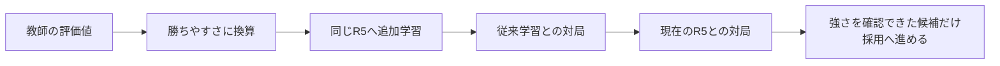

# 原因を切り分ける強化実験①：公開教師の評価尺度（2026-10-04）

現在のR5との200局で得点率41.5%と劣ったため、今回の候補は標準へ採用しなかった。初期得点率50%以上という次段階の条件に届かず、追加400局も行わなかった。 現在使用中のSailfish2 Time版とR5ネットは変更していない。

## なぜこれを試したか

5敗の分析では、時間を増やしても大きく改善しない局面が多かった。一方、特異延長や逃げ・守りの探索保護も、追加対局で明確な勝率改善を確認できなかった。そこで、今回は「局面を点数にする物差し」のずれを調べた。ただし、これが5敗の直接の原因と証明されたわけではない。

教師の点数は強いソフトが先を読んだ評価、R5の点数は今の局面から出す静的評価であり、差のすべてが間違いとは限らない。

## 見つかったずれと、一つだけ変更した内容

例えば、同じ「+500点」でも、評価を出すソフトによって実際の勝ちやすさは違う。これまで教師とSailfishの両方に同じ換算尺度K=600を使っていた。今回は学習用21,784局面の点数と勝敗から、教師側の尺度だけを調べ、100〜2000を5刻みで比較するとK=465が最良だった。

検証用1,176局面は尺度を選ぶ際に使用していない。そこでも教師の勝敗予測誤差（小さいほど良い）は0.55135→0.54424へ改善した。対局全体のIDがなく、完全に別対局での検証は保証できない点に注意。

**教師の換算だけ600→465へ変更。** Sailfish側K=600、学習元R5、24周、教師比率90%、学習率0.00005、1回1024局面、左右反転、2スレッド、同じデータと同じ合法性・静かな手のフィルタを維持した。複数の探索機能は同時に追加していない。

換算を指定しない学習は従来学習とSHA256が完全一致した。新しい符号・旧動作のテストを含む全32テストも成功した。

実際のR5出力で測った未使用局面の勝敗予測誤差は 0.64614→0.64233、教師との平均点数差は 396.8→386.0。これらは対局での強さそのものではない。異なる教師尺度で計算した学習ログの損失値同士を、そのまま改善率として比較してはいけない。

## 対局での確認

同じ標準Time実行ファイルを使い、評価ネットだけ切り替えた。1スレッド、Hash64、NetworkDelay0、並列4。同じ序盤で先後を入れ替え、初期比較と追加確認のseedを分けた。勝率には引分を半勝として含む。

| 比較 | 局数 | 1手時間 | 勝敗（今回の候補） | 得点率 | 先後ペア95%の目安 |
|---|---:|---:|---|---:|---|
| 従来の学習候補と比較 | 200 | 50ms | 92勝103敗5分 | 47.25% | 41.02〜53.48% |
| 現在のR5と比較 | 200 | 50ms | 82勝116敗2分 | 41.50% | 35.15〜47.85% |

初期R5比較の得点率が50%以上なら追加400局100msで確認する手順を、対局前に保存した。追加確認の95%目安の下限が50%を超えることを有望判定の条件とした。開始局面は4手のランダムな歩突きに限られ、seedが異なっても盤面が重複し得る。実施した各比較100組にはそれぞれ99種類の開始盤面があり、比較間で共通する盤面は11種類だった（`baseline/cause_opening_audit.json`）。区間は目安であり、floodgateのレートや長時間対局の強さには換算できない。

## 保存場所と次の進め方

公開教師の現在の保存場所：`C:/Users/goro0/OneDrive/Documents/shogi/public_teacher_by_mekitto.7z`（4,229,291,853 bytes、存在確認済み）。今回は過去に抽出済みの先頭40,000レコードのサンプルを使い、元の7zや既存データを上書きしていない。全181,867,500レコードを均等に抽出したデータではない。

候補：`baseline/nn_teacher_cal465.nn`。学習ログ：`baseline/cause_cal465_train.log`。診断：`baseline/cause_calibration_audit.json`。再現手順：`tools/audit-teacher-calibration.py`、`tools/test-teacher-calibration.py`。完了状態と標準ハッシュ：`baseline/cause_cal465_state.json`。

今回の換算値465は、このサンプルの勝敗予測には合っても、Sailfishの実戦には有効と確認できなかった。次は教師サンプルの偏りや、負け局面に近い攻防が学習データにどれだけ含まれるかを調査してから、変更を一つだけ選ぶ。全教師データが役に立たないという結論ではない。採用できなかった実験をまとめて有効にせず、候補作成→対局検証→採否の順で進める。
