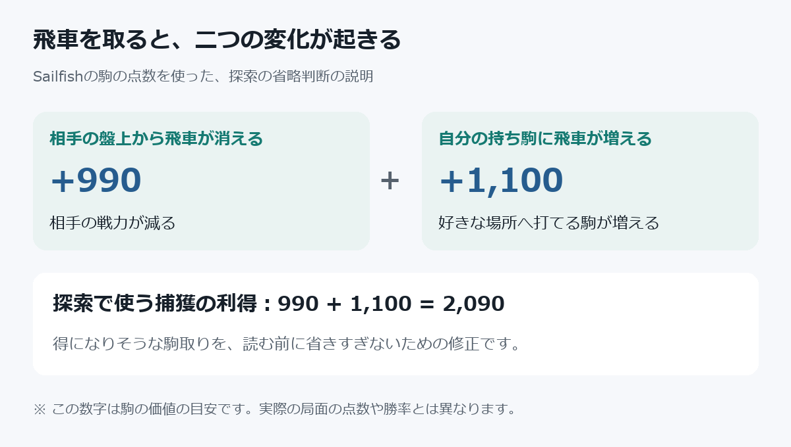

# Sailfish2 戦術探索と駒交換の強化検証
2026-10-02開始、2026-10-03検証。学習ネットワークR5は維持。今回は探索の変更を検証した。比較エンジンの出力を教師データに使用していない。

## 採用した強化と、現在の状態
**捕獲利得と成り利得の修正だけを標準へ採用した。** 新しい名前は Sailfish 2.1 Codex Delta。学習ネットワークは第5世代（R5）のまま。

旧版との再確認600局で321勝271敗8分、得点率54.2%。先後ペアを単位とした95%の目安は50.1〜58.2%。今回の短い持ち時間では改善を確認できた。水匠5との再測定はまだ行っておらず、従来の水匠戦46.4%が更新されたという意味ではない。

中学生向けに説明すると、将棋で相手の飛車を取ると「相手の飛車が盤面から消える」と「自分が飛車を持ち駒にできる」の二つが起こる。従来は、読む手を省略する判断で後者を数えていなかった。そのため、得になりそうな駒取りを早く切り捨てる場合があった。今回は、その省略判断を直した。

図の2090は省略判断に使う内部の目安。局面の評価値や勝率が2090増えるという意味ではない。

## 確認できた不備と修正
従来の静的交換評価（SEE）は盤上の価値だけで金とと金を同じ540としていた。将棋では金を取ると金が持ち駒になり、と金を取ると歩が持ち駒になる。
実験した新しいSEE判定では「盤上から取り除かれる価値＋持ち駒になった価値」を使用し、再捕獲に使う駒の選択もこの価値で行う。このSEE全体の変更は本確認で改善が確認できず、不採用。値は既存のPIECE_VALUEとHAND_VALUEに合わせた。
- 金の捕獲価値: 540+600=1140
- と金の捕獲価値: 540+100=640
- 銀が取り返せる位置で、と金で金を取る例: 旧0、新+500
- 同様に、金でと金を取る例: 旧0、新-500
SEEは駒の利きを使う近似で、ピン・全ての成り・詰み・局面全体の良さを完全に解くものではない。NNの評価関数そのものは変更していない。

実験用Feat65536で持ち駒込みSEE、Feat131072でDeltaの捕獲利得と成り利得を修正。旧版相当49にORして切り分けた。採用後の既定値は131121。
持ち駒込みSEEだけの候補はFeat65585、両方は196657。

## 王手と詰みの試作
盤面・持ち駒・履歴・hashを変更せず、移動後の占有を使って王手を判定するgives_checkを追加。
mate_in_oneは合法な王手を試し、すべての合法応手を調べ、応手がない場合だけ詰みとして返す。打ち歩詰めは除外する。局面は必ず元に戻す。
静止探索で王手を追加する範囲や、負ける取り合いに見えても王手なら読む範囲、PVでの1手詰み確認を切り替えて試した。
追加の王手を読む局面と捕獲だけを読む局面は探索の条件が異なるので、追加側でcapture-only QSのTT境界を使い回したり保存したりしない。
王手を読む範囲を広げた案は実戦で悪化。改善は「読みを増やすだけ」では不十分だった。実験機能は標準へ一律採用しない。

## 初期比較: 各200局、1手50ms、Threads1、Hash64、並列8
同じ序盤で先後を交換。得点率は勝ち1、引き分け0.5。95%区間は先後のペアを単位とした概算。
複数の試験が一部重なったため、これは候補を選ぶ探索的比較。絶対速度や最終的な棋力を断定する試験ではない。複数案から選んだ初期結果だけで採用を決めない。

| 候補 | 勝 / 敗 / 分 | 得点率 | ペア95%目安 |
|---|---:|---:|---:|
| 王手になる駒取りを広く保護 | 82 / 114 / 4 | 42.00% | 35.22 - 48.78% |
| 広い王手保護＋PVで1手詰み確認 | 88 / 108 / 4 | 45.00% | 39.09 - 50.91% |
| 静止探索入口で王手を追加 | 64 / 133 / 3 | 32.75% | 26.15 - 39.35% |
| PVで1手詰み確認のみ | 96 / 102 / 2 | 48.50% | 42.01 - 54.99% |
| PVの王手保護＋1手詰み | 84 / 108 / 8 | 44.00% | 37.07 - 50.93% |
| PVの最初3手で王手追加 | 43 / 153 / 4 | 22.50% | 17.04 - 27.96% |
| 持ち駒を反映した取り合い判定 | 104 / 90 / 6 | 53.50% | 46.26 - 60.74% |
| 取り合い判定＋Delta利得の修正 | 106 / 92 / 2 | 53.50% | 46.68 - 60.32% |

## 本確認の結果
両案とも相手は更新前の Sailfish 2.1 Codex、R5。同じ序盤で先後を交換する。Threads1、Hash64MB、NetworkDelay0、並列8。初期選別とは異なるseed範囲で再確認した。

| 候補 | 条件 | 勝 / 敗 / 分 | 得点率 | ペア95%目安 | 判断 |
|---|---|---:|---:|---:|---|
| 持ち駒込みSEE全体 | 600局、1手150ms、seed1001〜1300 | 285 / 300 / 15 | 48.75% | 45.04〜52.46% | 不採用 |
| Delta利得のみ | 600局、1手50ms、seed3001〜3300 | 321 / 271 / 8 | 54.17% | 50.12〜58.21% | 採用 |

得点率は勝ち1、引き分け0.5。序盤はランダムな歩の4手。seed範囲を変えているが、同じ手順が偶然生成される可能性までは除外していない。一部の試験は並行実行した。区間は先後ペアのばらつきからの概算で、すべての対戦相手・持ち時間での改善を保証するものではない。特に採用案は1手50msの短時間での結果なので、長い持ち時間と別エンジンでの確認が次の課題。

両方の本確認で反則手による終局は0。Delta単独は詰み592局、手数上限5局、千日手3局。最終版の探索が採用候補と一致することを別途確認してから標準へ反映した。

## 確認
- 18件のテスト成功。王手判定の差分一致、盤面の復元、打ち歩詰めの除外、1手詰み、成駒の持ち駒価値を含む。
- 機能OFF（Feat49）で6局面・深さ9の手/点数/PV/探索数が標準と完全一致。
- 取り合い候補の64局面・200k nodesで比較エンジンとの手の一致は旧23/64、新23/64。正解率・勝率を意味しない。
- 最終標準と採用候補も6局面・深さ9の手/点数/PV/探索数が完全一致（delta_final_equivalence.json）。
- 最終標準でUSIの時間制御、stop、MultiPV、ponder、20回連続go、quitを確認。Threads4でも成功。

## 保存物
baseline/tactical_*_200.json: 王手・詰み試作6案の対局結果。
baseline/exchange_see_200.json、exchange_both_200.json: 取り合い試作。
baseline/exchange_see_holdout600.json、exchange_delta_holdout600.json: 本確認。
baseline/exchange_64positions.json、exchange_default_compat.json、exchange_tests.log、exchange_usi.log、exchange_usi4.log。
target_exchange/release/sailfish2.exe: 取り合い候補、標準とは別ビルド。
tools/match.mjsは--seed-offsetを追加、未指定時は従来の序盤seedを維持。

## 捕獲利得の回帰確認
処理確認用の人工SFEN kgg6/9/4r4/4G4/9/9/9/9/8K b - 1 を使い、NNなしの手作り評価で静止探索のalpha=0、beta=1000を比較。
従来の捕獲利得990では、飛車を取る手5d5cを読む前に省略して不利の点数で返す。持ち駒の1100も足した利得2090では、この手を読み、有利の点数とPV5d5cを返すことをテストで確認した。
小さな人工局面の処理の確認であり、このテストだけでNN使用時の全対局の強さを保証しない。
図: output/figures/捕獲利得の修正.png

追加の切り分け:
- Feat262193: 持ち駒込みSEEを手の並べ方だけに使用。seed2001-2100、200局50ms、99勝95敗6分、51.0%。
- Feat131121: Deltaの捕獲利得だけを修正。seed2001-2100、200局50ms、107勝87敗6分、55.0%。
- Delta単独の再確認はseed3001-3300、600局50msで321勝271敗8分。採用。

## 標準版・アプリへの反映と戻し方
通常の target/release/sailfish2.exe と、隣の ShogiArena の次の2か所を更新済み。

- engines/sailfish2.exe
- dist/win-unpacked/resources/engines/sailfish2.exe

3か所とも起動してUSI名 Sailfish 2.1 Codex Delta と readyok を確認。アプリは開き直すと新しい実行ファイルを読み込む。GUIのソースや配布インストーラー、Sailfish1は変更していない。Gitへのコミット・push・公開リリースは行っていない。

標準のSHA-256:
9ea053461cffbeac66475b76524588b3c424c12ee708c6c193f41cf3ed7a32ae

変更前の標準は baseline/sailfish2_before_delta.exe（SHA-256: 367cc5ede98c490301670b129eaa2c2ce1f1ec28b6e1ec6cac2a3d17277c2f13）。
変更前のアプリ同梱版は baseline/sailfish2_arena_before_delta.exe（SHA-256: be92516fe7e7563631d4abf5d38dde63a015a403c2325c53ef26515976a388e2）。両アプリ配置先の旧版は同一だった。
戻す場合はアプリを終了し、対応するバックアップを元の配置先へコピーする。更新履歴は baseline/delta_arena_deployment.json。

R5ネットのSHA-256:
4e800fc73a799ef2dfe3781aa575df4455b10d6b9dbdbc3de631457fecf006aa

最終確認ログ: baseline/delta_final_tests.log（18件成功）、delta_final_usi.log、delta_final_equivalence.json。
王手を追加する機能、1手詰み確認、持ち駒込みSEEは実験用として残すが、標準ではOFF。旧探索へ切り替える診断値はFeat49。通常利用ではFeatを設定する必要はない。
