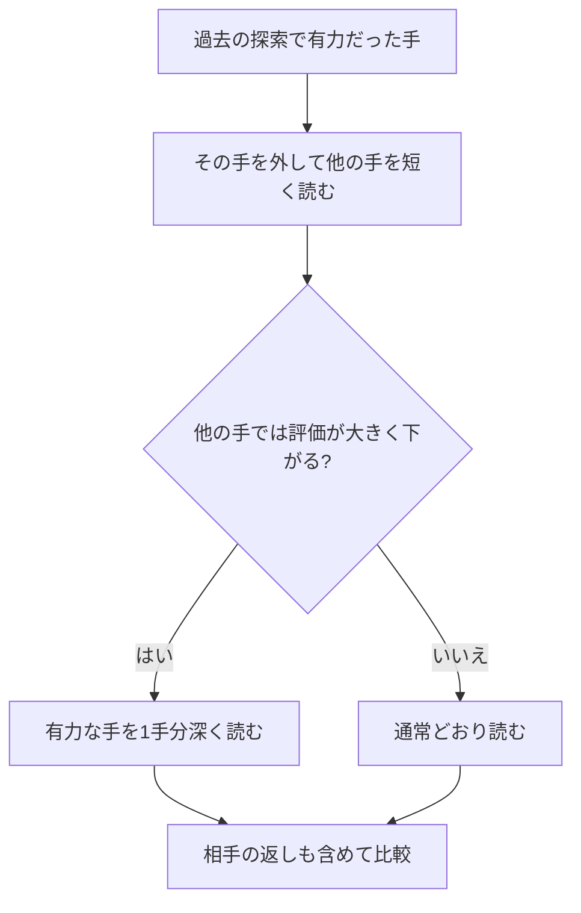

# 特異延長の実装と対局検証（2026年10月4日）

**特異延長を実装し、重要局面と旧版との対局で検証しました。強さの改善を確認できず、標準版への採用を見送りました。**

## どういう方法か

有力な手を一度候補から外し、「それ以外の手でも大丈夫か」を短めに調べます。ほかの手では評価が大きく下がるなら、その有力な手を通常より1手分深く読みます。

たとえば、相手の攻めを防げる手が1つしかなさそうな場面で、その守りと相手の返しを詳しく調べる狙いです。すべての手を深く読む方法より計算を集中できますが、確認作業そのものにも時間がかかります。確認で省いた手の先に危険がある可能性もあり、絶対に読み落とさないという保証にはなりません。

## 実装した条件

- 通常の探索で深さ7以上に達した局面が対象。指し手を選ぶ最初の局面と、王手を受けている局面は対象外です。王手への既存の延長は維持しています。
- 置換表に、十分な深さで読んだ有力な手と、確定値または下限値がある場合だけ確認します。違法な手や詰みの評価値は使いません。
- 有力な手を外した確認は、通常の約半分の深さで行います。「元の評価−3×探索深さ」の基準へほかの手が届かなければ、その手を1手分延長します。
- 確認のための探索で、さらに特異確認を繰り返すことはありません。延長の対象も、最初の反復の深さに対して2倍の手数以内に制限します。

「有力な手を使えない局面」は、通常の将棋の局面とは条件が違います。そのため確認の起点では、通常の置換表の評価を結論として流用せず、確認結果も通常の評価として保存しません。ほかの手がない場合を本当の詰みと取り違えない処理も入れています。確認の起点では、パスを仮定する省略や、静かな手の一部を省く処理も抑えています。

## 動作と正しさの確認

**27件のテストが成功しました。** 新規4件は、通常の置換表との分離、唯一の合法手を外した場合、特異延長の発動、確認中に停止した場合の局面・状態の復元を調べます。

機能を無効にした候補は、標準Time版と6局面・深さ9で指し手、評価値、読み筋、探索局面数が一致しました。有効にした候補でも、4スレッドでの停止、MultiPV、ponder、秒読み、連続した探索、終了の動作確認は成功しています。

## 対局結果

相手は現在の標準Time版、R5ネットは双方で同じです。1スレッド、Hash64MB、NetworkDelay0、4対局を並行実行しました。同じ開始局面の先後を交替しています。最初の100局を終える前に、初期得点率が45%以上なら別のseedを使う400局へ進む条件と、追加400局の先後ペア95%目安の下限が50%を超えたら採用検討する条件を記録しました。

| 比較 | 勝ち | 負け | 分け | 得点率 | 先後ペア95%の目安 |
|---|---:|---:|---:|---:|---:|
| 100局・1手50ms | 50 | 50 | 0 | 50.0% | 40.71〜59.29% |
| 400局・1手100ms | 212 | 181 | 7 | 53.9% | 49.00〜58.75% |

追加400局は212勝181敗7分、得点率53.875%でした。勝ち越したものの、95%の目安には互角の50%が含まれます。今回の結果だけでは改善を確定できず、標準採用を保留しました。

得点率は引き分けを半勝として数えます。初期100局と追加確認は、開始局面のseedを変えて別々に集計します。初期の結果と合算して採用判定しません。短い持ち時間の比較であり、floodgateのレートや5分の対局での棋力差を示すものではありません。

開始局面も確認しました。初期50組は50種類、追加200組は193種類の盤面でした。初期と追加で共通する盤面は17種類あります。seedを変えても同じ盤面になる例があり、この95%値は目安として扱います。別seedは、すべて異なる局面という意味ではありません。

## 危険な局面での読み

以前調べた5敗から選んだ局面など、計8局面を100万ノードと1秒で比較しました。全候補手と最終的な読み筋の合法性を確認しています。

以下は同じ100万ノードの上限での結果です。終了時に未完了だった反復ではなく、最後に読み終えた反復を比較しています。点数がマイナスなら手番側が不利と考えています。表の深さは読み終えた反復の深さで、延長によって部分的に深く読んだ量をすべて表すものではありません。

| 局面 | 標準の手 / 点数 | 特異延長の手 / 点数 | 完了した深さ（標準 / 特異延長） |
|---|---|---|---:|
| loss4_56 | 3c2e / -343 | 3c2e / -424 | 12 / 11 |
| loss6_80 | P*7c / -426 | P*7c / -426 | 9 / 8 |
| loss7_139 | 8i7h / -524 | 8i7h / -524 | 9 / 8 |
| loss9_143 | 3e3d / -265 | 3e3d / -265 | 6 / 6 |
| loss14_90 | R*6h / -411 | R*6h / -615 | 8 / 7 |
| loss7_131 | N*5f / -194 | N*5f / -194 | 10 / 9 |
| loss7_135 | 7f8f / -214 | 7h7g / -233 | 9 / 8 |
| loss7_137 | 1a3a+ / -247 | 1a3a+ / -225 | 9 / 8 |

有力手へ計算を集中した分、全体の反復の深さが低くなる例もあります。第9局143手目では、100万ノードの上限でも完了した深さは双方6で、手・評価・完了反復のノード数が一致しました。十分な深さまで入れない局面を、この深さ条件の方法で救えるとは確認できません。評価や候補が変わっただけでは正解と判断できません。以前の長時間分析も同じSailfishによる分析であり、答えを保証する教師ではありません。今回の比較では、危険を安定して早く見抜けるようになったとはまだ確認できません。

## 現在の配置と保存先

標準実行ファイル3か所とR5ネットは変更していません。ソースには特異延長を残し、既定では無効にしています。候補は別保存してあるため、条件を調整した実験に使えます。

- 実装: `src/search.rs`、実験用ビット `F_SINGULAR=8388608`。現行Timeに追加する実験設定は `Feat=8519729`。
- 候補実行ファイル: `target_singular/release/sailfish2.exe`。この候補は既定では特異延長無効なので、有効化には上記Feat設定が必要です。
- 実験前ソース: `baseline/search_before_singular_20261004.rs`
- 保存した候補ソース: `baseline/search_singular_candidate_20261004.rs`
- 状態と対局条件: `baseline/singular_experiment_state.json`
- 局面の詳細な読み筋: `baseline/singular_positions.json`
- 対局: `baseline/singular_screen100_50.json/.log`、`singular_confirmation400_100.json/.log`
- テスト: `baseline/singular_final_tests.log`、`singular_disabled_equivalence.json`、`singular_usi.log`
- 再現用ツール: `tools/test-singular.py`、`tools/report-singular.py`。保存済みの結果を上書きしないため、実験スクリプトの再実行は拒否する作りです。

GitHubへの公開や追加学習は行っていません。
