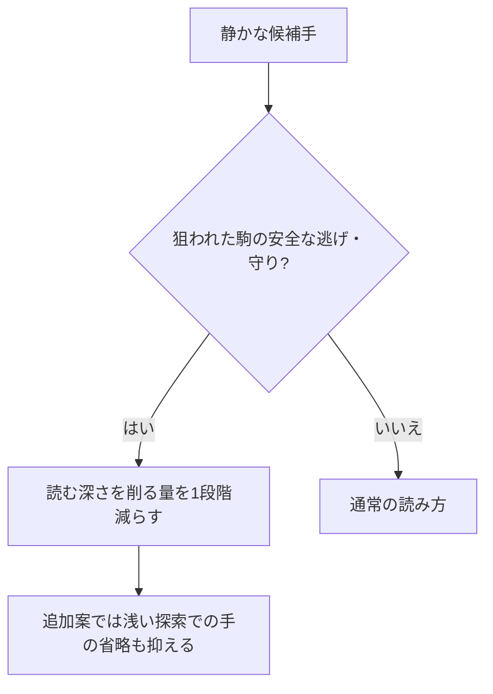

# 大事な逃げ・守りを浅く読みすぎない探索（2026年10月4日）

**攻撃されている駒の逃げや、大駒を守る手を読みの省略から保護する機能を実装しました。改善はまだ確定できず、標準版への採用を保留しました。**

## どんな手を詳しく読むか

将棋ソフトは、後の順番で調べる静かな手を浅く読んだり、省いたりして時間を節約します。その中に大事な逃げや守りが混ざることがあります。今回は、次の手を見つけたときに、読む量を少し増やします。

1. 相手に攻撃され、味方の守りがない駒を、安全に逃がす手。
2. 相手に攻撃され、守りがない飛車・角・龍・馬に守りを加える手。
3. 相手の攻撃の通り道へ駒を置き、大駒への攻撃を遮る手。

普通の歩は逃げの判定から外し、桂馬以上の駒価値を持つ駒を対象にします。玉への王手の対応は、既存の仕組みで詳しく読んでいます。新しい判定は、王手を受けていない局面の深さ2以上で使います。

たとえば、飛車が狙われているとき、飛車を逃がす手や、その前に金を打つ手を早々に見切りにくくします。ただし、移動先で取り合いになる場合の簡単な損得計算がマイナスになる手は、この保護から外します。駒の利きと簡易交換評価による目安であり、詰みや手の正しさを証明するものではありません。

## 分けて試した2つの設定

| 設定 | 変更 |
|---|---|
| 浅くする量を減らす | 後の順番の静かな手を浅く読む量（LMR）を、対象手だけ1手分減らす |
| 浅くする量＋手の省略を抑える | 上記に加え、浅い探索で候補手を丸ごと省くLMP・futilityの対象から外す |

既に守られた駒を逃がす手や、守りに関係のない駒打ちまで広く保護することは避けます。判定結果を局面内で再利用して、同じ駒の危険を何度も調べる負担を抑えます。前回の特異延長は無効にし、この機能の効果を分けて比較しました。R5ネットと時間配分は同じです。

## 動作確認

新規4件を含む**31件のテストが成功**しました。安全な逃げ、危険な逃げ、守り駒の追加、攻撃線を遮る駒打ち、無関係な駒打ち、既に守られた駒の扱いを確認しています。

機能を無効にした候補は、標準Timeと6局面・深さ9で、指し手・点数・読み筋・探索局面数が一致しました。有効にした4スレッドでの停止、MultiPV、ponder、時間制限、連続探索の動作確認も成功しました。

## 対局結果

標準Timeと、同じ開始局面で先手・後手を交替して比較しました。1スレッド、Hash64MB、NetworkDelay0、4対局を並行実行しています。初期は2設定を各100局50msで比較し、得点率が最良の設定が45%以上なら、別seedの400局100msで確認する手順を事前に決めました。採用検討の条件は、追加400局の先後ペア95%目安の下限が50%を超えることです。

| 設定と条件 | 勝ち | 負け | 分け | 得点率 | 先後ペア95%の目安 |
|---|---:|---:|---:|---:|---:|
| 浅くする量を減らす・100局/50ms | 57 | 40 | 3 | 58.5% | 49.15〜67.85% |
| 浅くする量＋手の省略を抑える・100局/50ms | 51 | 48 | 1 | 51.5% | 41.76〜61.24% |
| 浅くする量を減らす・400局/100ms | 193 | 197 | 10 | 49.5% | 44.80〜54.20% |

選んだ設定は「浅くする量を減らす」です。得点率は引き分けを半勝として数えます。初期と追加確認を合算して採用判断しません。短い持ち時間の測定であり、floodgateのレートや5分の対局での棋力差はまだ測っていません。別seedでも開始局面が重なる可能性があるため、95%の値は目安です。

開始局面の監査では、初期の2設定は各50組で50種類と50種類、追加の200組は191種類の盤面でした。追加と初期で共通する盤面は24種類です。別seedは、すべて異なる開始局面という意味ではありません。監査結果は`baseline/guard_opening_audit.json`へ保存しました。

追加400局は193勝197敗10分、得点率49.5%でした。先後ペア95%の目安は44.80〜54.20%で、互角の50%を含みます。初期の58.5%は追加で再現できず、この設定を標準版へ採用しませんでした。

## 以前の負けた局面での読み

重要な8局面を、100万ノードの上限と1秒で比較しました。以下はノード上限の比較で、終了時に未完了だった反復を除いた最後の結果です。点数がマイナスなら手番側が不利と考えています。全候補手・読み筋の合法性を確認しました。

| 局面 | 標準の手 / 点数 / 深さ | 浅くする量を減らす | 手の省略も抑える |
|---|---|---|---|
| loss4_56 | 3c2e / -343 / 深さ12 | 3c2e / -405 / 深さ13 | B*6d / -449 / 深さ11 |
| loss6_80 | P*7c / -426 / 深さ9 | P*7c / -426 / 深さ9 | P*7c / -325 / 深さ8 |
| loss7_139 | 8i7h / -524 / 深さ9 | 8i7h / -753 / 深さ8 | 8i7h / -753 / 深さ8 |
| loss9_143 | 3e3d / -265 / 深さ6 | 3e3d / -265 / 深さ6 | 3e3d / -497 / 深さ7 |
| loss14_90 | R*6h / -411 / 深さ8 | R*6h / -411 / 深さ8 | 8f8g+ / -809 / 深さ7 |
| loss7_131 | N*5f / -194 / 深さ10 | N*5f / -154 / 深さ9 | N*5f / -154 / 深さ9 |
| loss7_135 | 7f8f / -214 / 深さ9 | 7h7g / -186 / 深さ8 | 7h7g / -186 / 深さ8 |
| loss7_137 | 1a3a+ / -247 / 深さ9 | 1a3a+ / -247 / 深さ9 | 1a3a+ / -247 / 深さ9 |

第7局139手目では、両保護案が標準より厳しい評価を出しました。一方、同じ局面の1秒比較では、保護案の評価は標準より楽観的でした。詳しく読む手が増えると、全体の反復を読み終える深さが下がることもあります。点数が下がっただけ、候補が変わっただけでは正解と判断できません。以前の長い分析も同じSailfishによるもので、答えを保証する教師ではありません。

## 保存先と現在の状態

標準Time実行ファイル3か所とR5ネットは維持しました。実装はソースへ残し、既定では無効です。候補も別保存しています。

- 実装: `src/search.rs`、`TacticalThreats`と静かな手の保護。
- 候補: `target_guard/release/sailfish2.exe`。既定では保護機能は無効です。
- LMR保護: `F_TACTICAL_GUARD=16777216`、実験設定`Feat=16908337`。
- 浅い手の省略も保護: `F_TACTICAL_PRUNE=33554432`を追加、`Feat=50462769`。
- 実験前ソース: `baseline/search_before_guard_20261004.rs`。保存候補: `baseline/search_guard_candidate_20261004.rs`。
- 状態: `baseline/guard_experiment_state.json`。
- 局面の詳細: `baseline/guard_positions.json`。
- 対局: `baseline/guard_*screen100_50.json/.log`、選択設定の`*confirmation400_100.json/.log`。
- テスト: `baseline/guard_tests.log`、`guard_disabled_equivalence.json`、`guard_usi.log`。
- 再現ツール: `tools/test-guard.py`、`tools/report-guard.py`。保存結果がある場合は対局スクリプトの再実行を拒否します。既存結果を上書きしないでください。

追加学習、定期監視、GitHubへの公開は行っていません。
